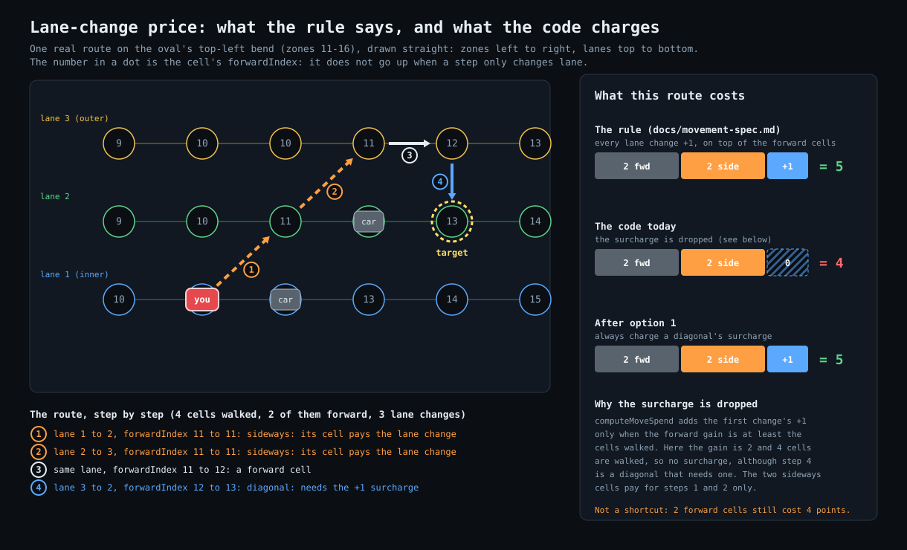
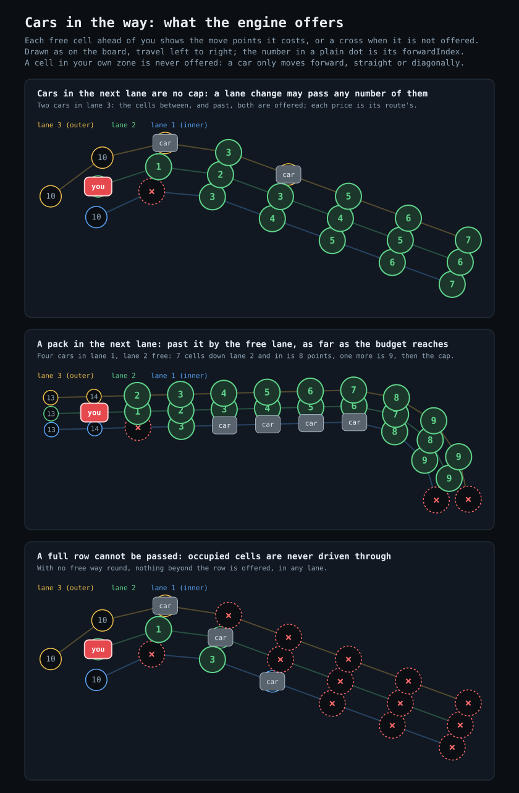
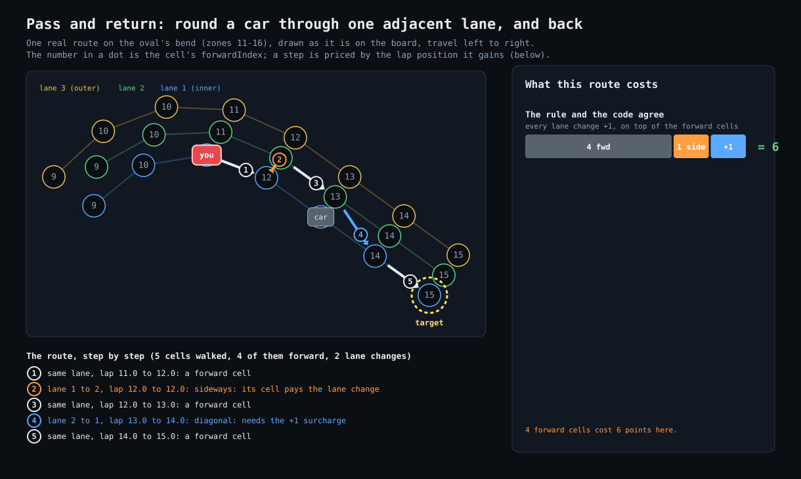
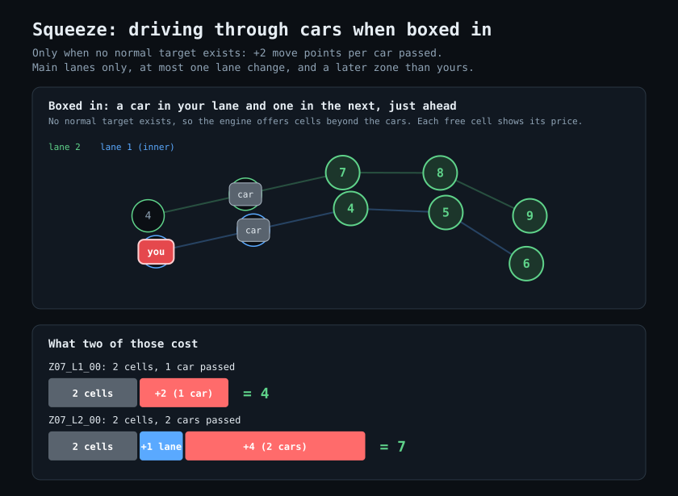
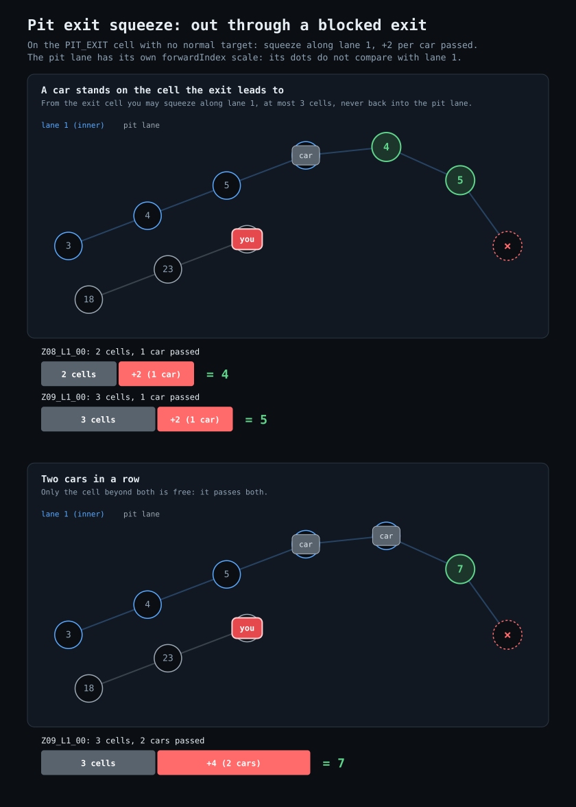
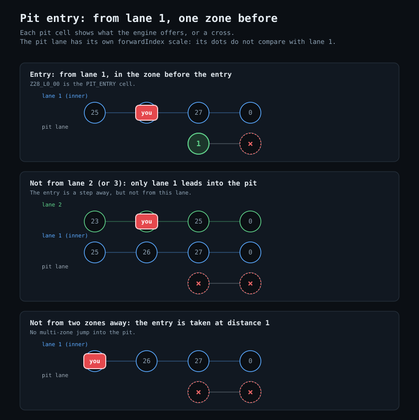
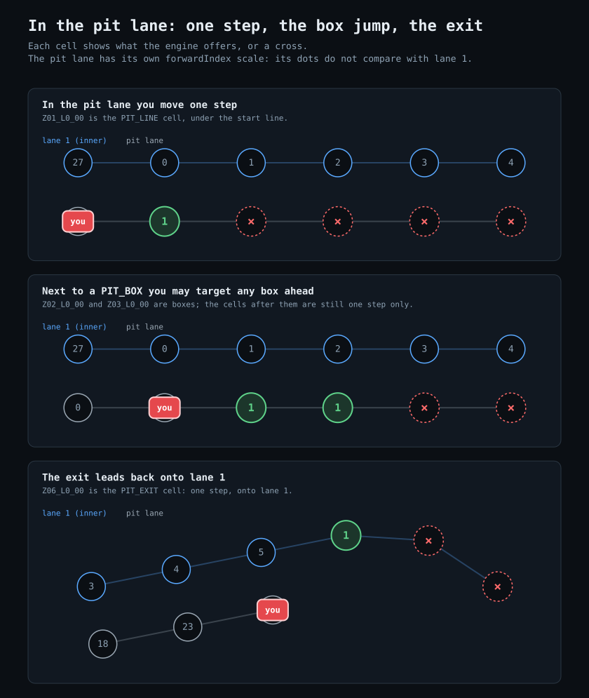

# Movement Spec (v0)

This doc summarizes the current movement rules implemented in `src/game/systems/movementSystem.ts`.
The turn flow around them (validate, apply, pit penalty, laps, winner) lives in `src/game/race/raceEngine.ts`
and is shared by single-player and the multiplayer server.

## Core Model

- Track movement uses the directed graph defined by each cell’s `next[]`.
- Valid targets are computed with BFS from the car’s current cell.
- `forwardIndex` is **not** used for movement; it is for ordering/progress only.

## Step Budget

- The active car has a max step budget (based on tires/fuel and remaining move budget). The cycle budget is 40, +1 for
  Low wing, -1 for High wing, +1 for the soft compound (`cycleBudget`).
- If the car starts in the pit lane (lane 0), the max steps are forced to `1`.
- Move spend is based on traveled distance, with a price for every lane change between main lanes (see "Price of a lane change").
- Pit-lane movement spend remains `1`.

## Price of a lane change

Every lane change between main lanes costs +1 move point on top of the forward cells. A sideways change (same
`forwardIndex`) pays it as the extra cell it walks; a diagonal change pays it as the surcharge in `computeMoveSpend`.

- A route with one lane change costs what it always did: `computeMoveSpend(distance, startLane, targetLane, forwardDelta)`
  (surcharge `+1` when the lanes differ and the forward gain is at least the distance walked).
- Every further diagonal change adds `+1`: `price = computeMoveSpend(...) + max(0, diagonals - (startLane != targetLane ? 1 : 0))`.
  Out and back (same start and target lane) costs `+2`; a zig-zag of three changes ending in another lane costs `+3`.
- The search is by price, not by steps: `searchRoutes` walks (cell, diagonal changes) states and keeps, per cell, the
  cheapest route (price, then fewest steps). Tire and fuel are charged on the cells walked on that route
  (`TargetInfo.distance`), not on the lane-change points. The 9-point cap applies to the price.
- `TargetInfo.laneChanges` is set only when the route changes lane 2 or more times; the hover tooltip then says
  "(N lane changes)".

**Known mismatch (#100):** a route that walks sideways cells AND contains a diagonal change skips the diagonal's
surcharge (the endpoint test in `computeMoveSpend` needs forward gain at least the cells walked), so it costs one point
under the rule. The example below is one real route, drawn straight; the rule says 5, the code charges 4. Once #100 is
fixed the "code today" bar goes away.

## Costs

- Each valid target includes computed tire and fuel costs based on:
  - Distance traveled.
  - Lane factors (lane 1 is higher tire/lower fuel, lane 3 is lower tire/higher fuel).
  - Car setup (wing level and PSI deltas vs 32): Low wing x1.6 tire / x1.05 fuel, High x0.8 / x0.9 (see `docs/strategy-and-feel.md`).
- Costs are rounded to integers.

## Lane Change Rules

- You may only target a lane that is the same or adjacent to your start lane.
- Pit lane (lane 0) is special and handled by pit rules below.
- A lane-change target must advance forward progress: no target with the same `forwardIndex`, and none in the start's
  own zone (a car only moves forward, straight or diagonally; in the bend the inner lane's `forwardIndex` is one higher
  in the same zone, which by index alone would make a pure sideways move a diagonal, #108), except for `PIT_ENTRY`. The route to a target may still walk sideways cells on the way (going round a car): each is a cell
  walked and pays its lane change (see "Price of a lane change").

## Occupancy

- A target cell is invalid if it is occupied.
- Target-lane blocker policy:
  - For same-lane movement, the nearest occupied cell ahead is the blocker.
  - For lane changes, you may pass one blocker in the destination lane (merge in front of it, or into a gap).
  - Lane-change targets are blocked by the second blocker ahead in the destination lane. With only one car in that lane
    nothing blocks beyond it: a lone car can be passed like the first of two.
  - Pass and return: a same-lane target beyond the nearest same-lane blocker is legal when a free route goes round the
    blocker through ONE adjacent lane and rejoins your lane. Like a merge it may pass one blocker, not the next. The
    route stays in the two lanes, passes at most one car in the lane it goes round through, as a merge into it would
    (cells of that lane at or beyond its second car are not available to it), and pays for its lane changes (out and back is `+2`).
  - Adjacent lanes do not block unless they are the chosen destination lane.
- Occupied cells are not traversable during target search (except the start cell).

Which cells the engine offers around other cars: the move points on a free cell, or a cross when it is not offered.

Pass and return, one real route: out through the adjacent lane, past the car, and back. Out and back is two lane changes, so the route costs two points more than its forward cells.

## Squeeze (boxed in)

Only when an ACTIVE car has no normal target at all, `computeTargets` (raceEngine) returns squeeze targets from
`computeSqueezeTargets` instead of an empty map. When any normal target exists, squeeze is never offered.

- BFS over `next[]` up to `maxSteps` ignores occupancy for traversal, but the target cell must be free.
- Main lanes only (never PIT_ENTRY, pit lane or PIT_BOX), at most 1 lane change, `targetDelta > 0` and a later zone than the start (no backwards or pure sideways).
- `passed` = occupied main-lane cells in the start lane or the target lane (a lane counts once) with `0 < delta < targetDelta`.
  A squeeze target must have `passed >= 1`.
- `moveSpend = computeMoveSpend(...) + SQUEEZE_SURCHARGE_PER_CAR (2) * passed`, and must be `<= maxSteps`
  (remaining cycle budget / 9 cap). Tire and fuel costs stay the normal distance-based costs.
- `TargetInfo.squeezePassed` is set only for squeeze targets. Skip is legal only when there are no targets at all.

Example: car in lane 2 at forwardIndex 5, cars at 6 in lanes 1, 2 and 3. No normal target exists. Squeeze to
lane 2 at 7: distance 2, passes 1 car, move 2 + 2 = 4. To lane 1 at 7: distance 3, passes 2 cars, move 3 + 4 = 7.

The same on the inner lane, drawn from the engine (a car in your lane and one in the next): each free cell shows its price.

### Pit exit squeeze

A car starting on the cell tagged `PIT_EXIT` (only that cell; cars blocked inside the pit lane keep queueing single
file) with no normal target (the exit connection is occupied) also gets squeeze targets:

- Along lane 1 only (the exit connects to lane 1; no lane change), at most 3 cells from the start, never back into the pit lane, target cell free.
- `passed` = occupied cells on that path between the start and the target (pit-lane `forwardIndex` is on its own scale, so deltas are not used).
- `moveSpend = distance + 2 * passed` (a pit exit has no lane-change surcharge), `<= maxSteps`. Lap counting is unchanged and pit state resets exactly as after a normal exit.
- The HUD banner reads "Pit exit blocked - squeeze out (+2 points per car)".

Example: car on `Z06_L0_00`, another on `Z07_L1_00`. No normal target. `Z08_L1_00`: distance 2, passes 1, move 4.
`Z09_L1_00`: distance 3, passes 1, move 5. With `Z08_L1_00` also taken only `Z09_L1_00` remains: passes 2, move 7.

## Pit Rules

- You may only enter pit via a `PIT_ENTRY` cell, and only from lane 1.
- Pit entry is only allowed at distance 1 (no multi-zone jumps into pit).
- Once in pit lane, movement is constrained by the pit chain and `maxSteps = 1` **except**:
  - If you are adjacent to a `PIT_BOX`, you may target **any** `PIT_BOX` ahead (future‑proof for longer pit lanes).
- `PIT_BOX` targets can be disallowed by options (and are disallowed after a pit stop has been serviced).
- A special “pit exit skip” can add an extra target when applicable.

Entry, drawn from the engine: only from lane 1, only one zone before the entry cell.

In the pit lane, drawn from the engine: one step, the jump to a box from next to a box, and the exit onto lane 1.

## Options

- `allowPitExitSkip`: allows a computed pit-exit target when starting from a pit box.
- `disallowPitBoxTargets`: removes `PIT_BOX` cells from valid targets.

## Laps

Crossing the start line completes a lap, in any lane, whatever the move distance. Cars behind the line at the start
have `lapCount` -1, so their first crossing only starts lap 1. The race is won by the first car to reach `raceLaps`
completed laps (see AGENTS.md "Lap Counting").

- Main lanes: a `forwardIndex` wrap between two non-pit cells.
- Pit lane: the line crosses it at the cell tagged `PIT_LINE`. On `oval16_3lanes` the pit lane runs
  `Z28_L0_00` (`PIT_ENTRY`, pit `forwardIndex` 0, before the line) -> `Z01_L0_00` (`PIT_LINE`, directly under the
  `START_FINISH` cell `Z01_L1_00`) -> `Z02_L0_00`, `Z03_L0_00` (`PIT_BOX`) -> `Z04_L0_00`, `Z05_L0_00` -> `Z06_L0_00`
  (`PIT_EXIT`) -> `Z07_L1_00` (lane 1, `forwardIndex` 6). A pit-lane move credits one lap when it starts at a cell
  before `PIT_LINE` and lands on or beyond it (pit `forwardIndex` rises along the pit lane, so a jump to a box over
  the line would count too; on this track only `Z28_L0_00 -> Z01_L0_00` can happen, as a box is only offered from
  `Z01_L0_00`). Not credited: `Z27_L1_00 -> Z28_L0_00` (the entry itself is before the line), anything from
  `Z01_L0_00` onward, and the pit exit onto lane 1 (landing on `forwardIndex` 6 is not a wrap). A whole stop
  therefore credits exactly the lap an on-track car gets over the same stretch, and a stop only costs the lost
  turn and the one-step pit lane.
- A pit-lane crossing can finish the race: the car that completes `raceLaps` first wins, whichever lane it crossed in.
- Ranking and gaps: pit cells carry their own `forwardIndex` scale, so they are ranked by the lane-1 cell of the same
  zone (`trackFwd`): the entry (zone 28) stands beside lane-1 `forwardIndex` 27, `PIT_LINE` beside 0, the boxes beside
  1 and 2. A car at the pit entry has not crossed yet and ranks behind one just past the line; once it lands on
  `PIT_LINE` it ranks like a car that crossed on track.

### Why: F1

In F1 the Line extends across the pit lane: a car that crosses it in the pit lane completes the lap, and the
classification is by number of complete laps, then by the order in which the cars crossed the Line (2026 Sporting
Regulations, B2.5.5, as quoted by secondary sources). The reference case is the 1998 British Grand Prix at
Silverstone: Schumacher took his stop-go penalty in the pit lane, crossed the Line there and the win stood. The game
copies the lap rule only; there are no penalties. (In F1, late penalties are converted to race-time penalties so
nothing is served after the line.)

## Notes

- Movement targets are computed independently each turn.
- Any change to rules should include a unit test in `src/game/systems/movementSystem.test.ts`.

## Drafting (slipstream, issues #55 and #98)

A car is **tucked in** when it is in a main lane and another car (any owner) stands in the **same lane**, 1 to
`DRAFT_RANGE` (2) cells directly ahead by `forwardIndex` (wrapping at the start line). Adjacent lanes and the pit lane
(entry and exit included) never count. `draftAhead` in `src/game/systems/draftSystem.ts` is the only definition.

**When it is judged: at the end of the car's move, not at the start of its turn.** Every car has moved about 8 cells
between the end of one move and the start of the next turn, so a leader is never within 2 cells then (measured: 0 of
498 turns in solo races; #98). A move that ENDS tucked in puts the car in the tow for its next move, whatever the leader
does in between.

- **`Car.draftTurns`:** moves in a row that ended tucked in. After each `move` in `applyAction`: `draftTurns + 1` when
  the car ends it tucked in, else 0 (a move that ends elsewhere, a skip or a pit stop resets it). A grid `setup` is not a
  move. It starts at 0. So: a move that ends tucked in (1), the next move is discounted; ending tucked in again (2)
  opens the slingshot for the move after.
- **Wear:** a move that starts with `draftTurns >= 1` costs `DRAFT_FUEL_FACTOR` (0.8) of the fuel and
  `DRAFT_TIRE_FACTOR` (0.9) of the tire, applied in `computeCosts` with the other factors and rounded once. On the plain
  setup (hard, Medium wing) the tire discount rounds away on every move length; the fuel discount shows (1 point) on 4,
  6, 8 and 9 cell moves. `TargetInfo.drafted` marks the targets of such a move; the pit lane never gets it.
- **Slingshot:** with `draftTurns >= DRAFT_SLINGSHOT_TURNS` (2) a route with a lane change pays no +1 lane-change
  surcharge (`TargetInfo.slingshot`). The pass rules (one blocker, go-round) and the squeeze surcharge are unchanged:
  only the price drops. `TargetInfo.slingshotOnly` marks a slingshot that would be out of reach with the surcharge.
- **`Car.slingshots`:** the slingshot moves a car has played (the engine counts them in `applyAction`). It is a
  counter so a client can tell from two states that one just landed (the toast and the online feed line).
- **Which moves keep the tow:** a target whose cell is 1-2 behind a car in its lane (`RaceSession.endsTucked`), the cars
  where they stand now. The board marks them with a blue dashed ring and the tooltip says so.
- No lobby setting: always on. The engine computes it (`computeTargets`, `applyAction`), so solo and the server agree.
  The bots get it too: they end about 60% of their moves tucked in (the benchmark gate is in `docs/bot-system.md`).
